<div align="center">

<table align="center" cellpadding="0" cellspacing="0" border="0">
<tr><td align="center">

</td></tr>
<tr><td align="center">

</td></tr>
</table>

<!-- # render-strokes-order -->

**读取 QuickDraw 草图笔画，为每一笔赋予颜色并标注序号。**

[](https://www.python.org/)
[](LICENSE)
[](https://github.com/googlecreativelab/quickdraw-dataset)
[](https://matplotlib.org/)

</div>

---

##  环境要求

Python 3.9+，依赖：

```bash
pip install numpy matplotlib tqdm
```

---

##  快速开始

```bash
python render_strokes.py
```

所有可调参数集中在脚本底部的 `params` 字典，键名与 `main()` 形参一致：

```python
params = {
    'data_dir': '/workspace/data/datasets/quickdraw',
    'categories': sorted(["bee", "bus", "flower", "giraffe", "pig"]),
    'total_batches': 10,
    'batch_size': 100,
    'use_category_offset': True,
    'output_dir': 'outputs',
}
main(**params)
```

> 💡 备选类别：`airplane`、`angel`、`alarm_clock`、`apple`、`butterfly`、`belt`、`bus`、`cake`、`cat`、`clock`、`eye`、`fish`、`pig`、`sheep`、`spider`、`great_wall`、`umbrella`。

---

##  参数说明

| 参数 | 默认值 | 含义 |
|---|---|---|
| `data_dir` | `/workspace/data/datasets/quickdraw` | QuickDraw `.npz` 文件目录 |
| `categories` | — | 绘制类别，运行时按字母排序 |
| `total_batches` | `10` | 每个类别的批次数 |
| `batch_size` | `100` | 每批图片数，网格 10 列，行数自动 |
| `use_category_offset` | `True` | `True` 时编号跨类别连续，`False` 时每类从 1 开始 |
| `output_dir` | `outputs` | 文件根目录，相对路径按脚本目录解析 |
| `checkpoint_file` | `<output_dir>/checkpoint.json` | 断点文件位置，默认跟随输出目录 |

---

##  输出结构

```text
outputs/
├── checkpoint.json          # 断点与参数记录
├── bee/
│   ├── bee-1.png
│   └── bee-2.png
├── bus/
│   └── bus-1.png
└── ...
```

每张 PNG 为 10×10 网格（末批不足时隐藏多余子图），子图标题即该图的全局编号。

---

##  许可与致谢

- 项目代码采用 [MIT 协议](LICENSE)。
- 横幅与章节图标使用 Twemoji 素材（CC-BY 4.0，需署名），SVG 示意图为本地原创，详见 `LICENSE`。

<div align="center">

**[⬆ 回到顶部](#render-strokes-order)**

</div>